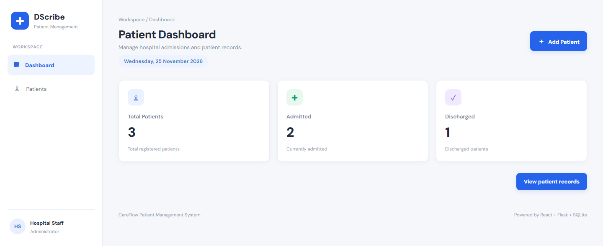

# DScribe Patient Admission Management

A responsive patient admission dashboard for hospital staff. The app supports adding, viewing, searching, filtering, editing, discharging, and deleting patient records. Login and signup are intentionally not included, as specified in the task.

## Task links

- Public GitHub repository: publish this project and add its URL here.
- Live application: deploy the frontend and backend, then add the URL here.

Deployment steps are in [DEPLOYMENT.md](DEPLOYMENT.md). The links above remain unfilled until the project is published and deployed.

## Screenshots




## Features

- Add and edit patient records with name, age, gender, ward, department, doctor, admission date, and status.
- View all patients and dashboard totals for registered, admitted, and discharged patients.
- Search by patient name and filter by ward, department, and doctor. Filters can be cleared or refreshed.
- Discharge an admitted patient and permanently delete a record after confirmation.
- Validate required fields and allowed values in both the React UI and Flask API.
- Use the dashboard on mobile, tablet, and desktop screens.
- Store records in SQLite so they remain available after the backend restarts.

## Technology

- Frontend: React 19 and Vite
- Backend: Python 3, Flask, and Flask-CORS
- Database: SQLite

## Run locally

Open two terminals from the project root.

### Backend

```powershell
cd backend
python -m venv venv
.\venv\Scripts\Activate.ps1
pip install -r requirements.txt
python app.py
```

The API starts at `http://127.0.0.1:5000`. On first launch it creates `backend/patients.db`.

### Frontend

```powershell
cd frontend
npm install
npm run dev
```

Open the local URL printed by Vite, usually `http://localhost:5173`. For a separately hosted API, set `VITE_API_URL` to the API base URL ending in `/api` before starting or building the frontend. The default is `http://127.0.0.1:5000/api`.

## API routes

| Method | Route | Purpose |
| --- | --- | --- |
| `GET` | `/api/options` | Get the allowed dropdown values |
| `GET` | `/api/patients` | List patients; supports `search`, `ward`, `department`, and `doctor` query filters |
| `POST` | `/api/patients` | Add a patient |
| `PUT` | `/api/patients/<id>` | Update a patient |
| `PATCH` | `/api/patients/<id>/discharge` | Mark a patient as discharged |
| `DELETE` | `/api/patients/<id>` | Delete a patient |

## Data and deployment

By default, SQLite stores records in `backend/patients.db`. Set `DATABASE_PATH` to choose another database file. For deployment, use persistent storage for this file and set `CORS_ALLOWED_ORIGINS` and the frontend's `VITE_API_URL`; see [DEPLOYMENT.md](DEPLOYMENT.md).

The app has no authentication. Keep it on a trusted network and do not use real patient information on a public deployment without appropriate access controls and privacy safeguards.
