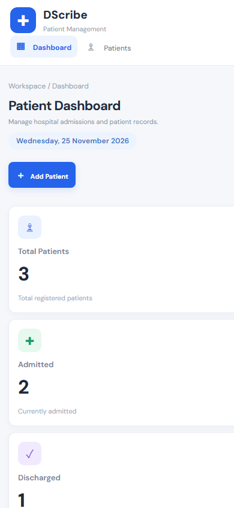

# DScribe Patient Admission Management

A responsive patient admission dashboard for recording and managing hospital admissions. The app supports adding, viewing, searching, filtering, editing, discharging, and deleting patient records.

## Links

- **Live app:** https://dscribe-patient-management-seven.vercel.app
- **API:** https://dscribe-patient-api.onrender.com
- **Source:** https://github.com/Shreya2244/DScribe-patient-management

## Screenshots




## Features

- Add and edit patient records with name, age, gender, ward, department, doctor, admission date, and status.
- View total, admitted, and discharged patient counts.
- Search by patient name and filter by ward, department, and doctor.
- Discharge or delete records with confirmation.
- Validate required fields and allowed values in both the frontend and API.
- Responsive layouts for mobile, tablet, and desktop.

## Technology

- **Frontend:** React 19 and Vite
- **Backend:** Python 3, Flask, Flask-CORS, and Gunicorn
- **Database:** SQLite
- **Hosting:** Vercel (frontend) and Render (API)

## Run locally

Open two terminals from the project root.

### Backend

```powershell
cd backend
python -m venv venv
.\venv\Scripts\Activate.ps1
pip install -r requirements.txt
python app.py
```

The API runs at `http://127.0.0.1:5000`. On first launch, it creates `backend/patients.db`.

### Frontend

```powershell
cd frontend
npm install
npm run dev
```

Open the local URL printed by Vite, usually `http://localhost:5173`. The frontend uses `http://127.0.0.1:5000/api` by default. To use another API, set `VITE_API_URL` to its base URL ending in `/api` before starting or building the frontend.

## API routes

| Method | Route | Purpose |
| --- | --- | --- |
| `GET` | `/api/options` | Get allowed dropdown values |
| `GET` | `/api/patients` | List patients; supports `search`, `ward`, `department`, and `doctor` filters |
| `POST` | `/api/patients` | Add a patient |
| `PUT` | `/api/patients/<id>` | Update a patient |
| `PATCH` | `/api/patients/<id>/discharge` | Mark a patient as discharged |
| `DELETE` | `/api/patients/<id>` | Delete a patient |

## Deployment and data

See [DEPLOYMENT.md](DEPLOYMENT.md) for deployment configuration. The frontend uses the `VITE_API_URL` environment variable, and the API uses `CORS_ALLOWED_ORIGINS` to allow the frontend origin.

Locally, SQLite stores records in `backend/patients.db`; set `DATABASE_PATH` to use a different file. The deployed Render service currently uses its free plan without persistent storage, so its SQLite records can be lost when the service restarts or is redeployed. Persistent storage is needed for records to survive those events.

This demo has no authentication or access control. Do not enter real patient information on the public deployment.
